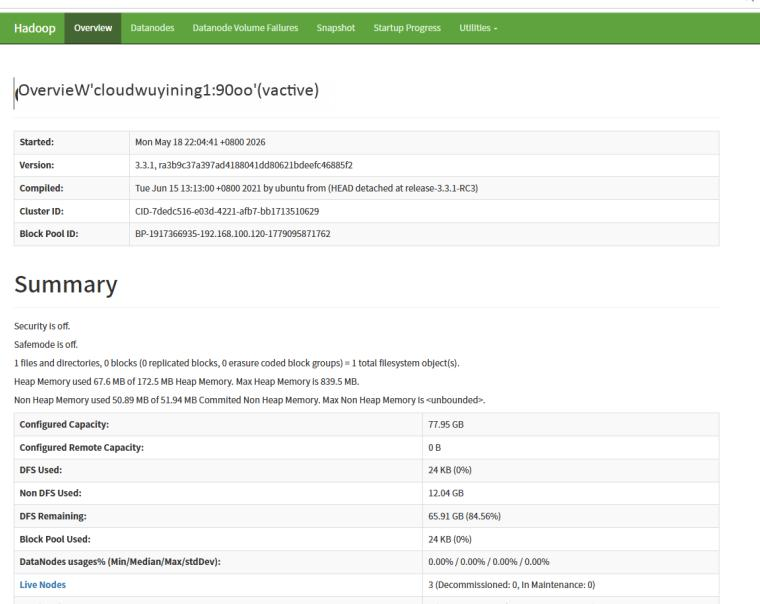
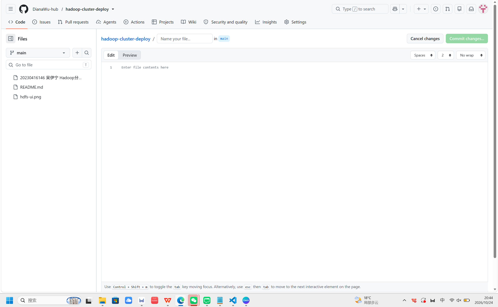

# 双节点Hadoop完全分布式集群部署实践
> 实验环境：VMware虚拟机，CentOS7，Hadoop‑3.3.1，JDK1.8
> ⚠️说明：本项目为虚拟机学习实验环境，用于练习集群部署与故障排查，**非线上生产集群**

## 🛠技术栈
- 操作系统：CentOS 7
- 大数据组件：Hadoop3.3.1（HDFS + YARN）
- 工具：VMware、SSH、vim、yum、jps

## 📋集群规划
|主机名|IP地址|角色|
|------|------|----|
|cloudwuyining1|192.168.100.119|主节点：NameNode、ResourceManager、SecondaryNameNode、DataNode、NodeManager|
|cloudwuyining2|192.168.100.166|从节点：DataNode、NodeManager|

## 🚀部署主要流程
1. 使用VMware克隆两台CentOS7虚拟机；配置NAT网络，设置静态IP；修改/etc/hosts主机名IP映射
2. 关闭防火墙firewalld、SELinux；配置SSH免密登录，实现节点之间免密互通
3. 所有节点安装JDK1.8，配置Java运行环境
4. 解压Hadoop安装包，修改核心配置文件：
   - `hadoop‑env.sh`：配置JAVA_HOME、日志、PID路径
   - `core‑site.xml`：配置HDFS默认访问地址、临时目录
   - `hdfs‑site.xml`：配置数据存储目录、副本数dfs.replication=2、块大小
   - `yarn‑site.xml`：ResourceManager地址、内存资源参数、shuffle服务
   - `mapred‑site.xml`：指定计算框架使用YARN，配置历史服务器
   - `workers`：填写集群工作节点主机名
5. HDFS格式化 `hdfs namenode -format`（仅执行一次）
6. 启动集群：`start‑dfs.sh`、`start‑yarn.sh`
7. 使用jps命令校验各节点进程；访问WebUI验证集群运行状态
    - HDFS UI：http://192.168.100.119:9870
    - YARN UI：http://192.168.100.119:8088/cluster

## 🖼运行界面截图
> 
> 

> 🔔jps进程说明（PDF文档仅文字记录，无截图）
> - 主节点预期进程：NameNode、SecondaryNameNode、DataNode、ResourceManager、NodeManager、Jps
> - 从节点预期进程：DataNode、NodeManager、Jps

## 🚨部署遇到故障与解决方案
1. **节点网络不通**
排查防火墙是否关闭；核对/etc/hosts IP‑主机名映射；ping测试两台虚拟机连通性；检查9000、8088、9870端口。

2. **SSH免密登录配置完仍需要输入密码**
检查`.ssh`目录权限700，`authorized_keys`文件权限600；确认公钥已经分发到全部节点；使用`ssh‑v`调试查看详细连接日志。

3. **Hadoop启动提示找不到JAVA_HOME**
确认`hadoop‑env.sh`中JAVA_HOME路径正确，使用`java ‑version`验证jdk安装。

4. **多次格式化NameNode，DataNode无法启动（ClusterID不一致）**
删除所有节点name、data、tmp数据目录；**只执行一次hdfs namenode -format**，重新启动集群。

## 📁仓库文件
- `20230416146 吴伊宁 Hadoop分布式集群及YARN集群部署使用.pdf`：完整课程大作业报告

## 📝学习收获
1. 掌握VMware多台Linux虚拟机网络、主机名、SSH免密整套环境部署流程
2. 理解HDFS存储、YARN资源调度组件的基础原理
3. 学会看报错日志，排查集群部署阶段常见故障，具备基础运维排错思维
4. 熟悉Hadoop多份核心配置文件的含义与修改方式
